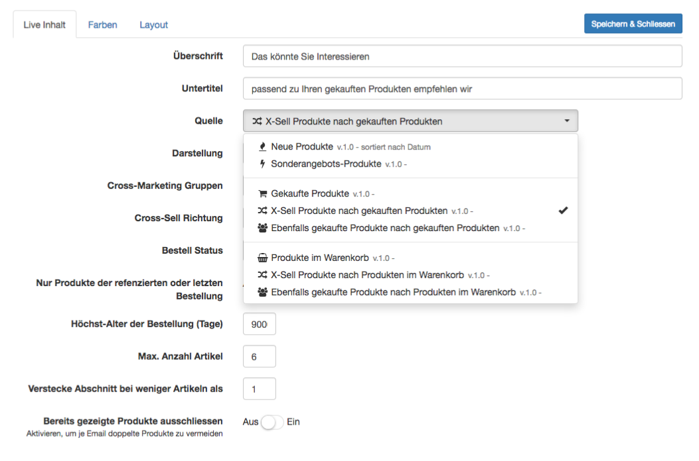

[doc-callout type="note" title="Frühere Moduleinstellungen"]
Einstellungen in der aktuellen App findest du unter [System](/app-system). [Zur Referenz für ältere Versionen](/legacy).
[/doc-callout]

Füge den Baustein `Live Content` ein, wenn eine Kampagne Produkte empfehlen soll. Wähle eine Quelle passend zur Nachricht. Eine Warenkorberinnerung kann die Artikel im Warenkorb zeigen, eine Nachbestell-E-Mail passende Produkte zu einem früheren Kauf.

Stimme die Empfehlungen auf den Anlass ab. Bei einer Erinnerung an einen offenen Einkauf sollte für den Kunden erkennbar sein, warum die aufgeführten Artikel in dieser E-Mail stehen.

- **Katalog** 
  Wähle Top-Produkte, nach Datum sortierte Neuheiten oder Sonderangebote.
- **Frühere Käufe** 
  Zeige Cross-Selling-Artikel oder häufig zusammen gekaufte Produkte passend zum bisherigen Einkauf.
- **Warenkorb** 
  Zeige den Warenkorbinhalt, Cross-Selling-Artikel oder Produkte, die oft mit diesen Artikeln gekauft wurden.

Bei bestellbasierten Quellen wählst du Bestellstatus und Zeitraum. Ein kürzerer Zeitraum gewichtet das jüngere, saisonale Kaufverhalten stärker. Zen Cart benötigt für Cross-Selling-Quellen [Cross Sell Advanced](https://www.zen-cart.com/downloads.php?do=file&id=400).

Mit **Bereits gezeigte Produkte ausschliessen** vermeidest du doppelte Artikel in mehreren Bausteinen. Modified-Shop und Gambio berücksichtigen standardmäßig FSK18- und Gruppenberechtigungen. Prüfe diese Vorgaben, bevor du die optionale Prüfung änderst. Auf anderen Plattformen ist die Option ausgeblendet.
