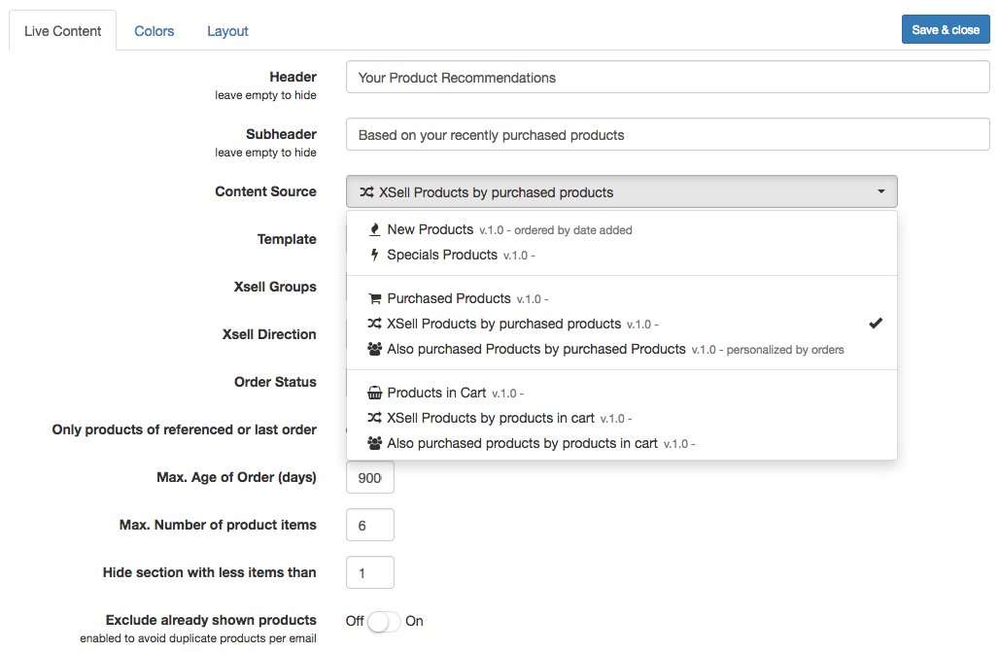

[doc-callout type="note" title="Earlier module settings"]
For settings in the current app, start with [System](/app-system). [Browse the legacy reference](/legacy).
[/doc-callout]

Add a `Live Content` block when a campaign should recommend products. Choose a source that matches the email. A cart reminder can show products in the cart, while a reorder email can suggest items bought with the customer’s previous purchase.

Match the recommendation to the reason for the email. A reminder about an unfinished purchase should still make sense when the customer reads the product list below it.

- **Catalog** 
  Choose featured products, new products sorted by date, or specials.
- **Past purchases** 
  Show cross-sell or frequently bought-together items based on what the customer purchased.
- **Cart** 
  Show the cart contents, cross-sell items or products frequently bought with items in the cart.

For order-based sources, choose which order statuses and how much order history to consider. A shorter window gives recent seasonal purchases more influence. On Zen Cart, cross-sell sources require [Cross Sell Advanced](https://www.zen-cart.com/downloads.php?do=file&id=400).

If you add several blocks, enable **Exclude already shown products** to prevent a product appearing twice. Modified-Shop and Gambio respect FSK18 and customer-group restrictions by default. Check these before changing the optional restriction setting. Other platforms do not show it.
